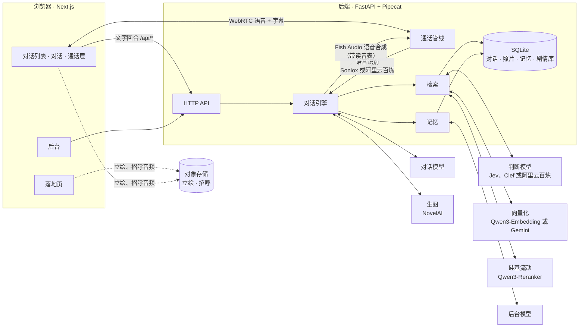

> **这是 [`Sallyn0225/eidolon-sc`](https://github.com/Sallyn0225/eidolon-sc) 的本地定制分支**（基于上游 `6d8565a6`）。
> 原项目是能和《偶像大师 闪耀色彩》的角色聊天、打电话、发照片的本地部署版；这个分支在它上面加了下面这些。

## 这个分支加了什么

| 功能 | 一句话 | 详见 |
|---|---|---|
| **群聊** | 2–4 个人一个对话，判断模型决定谁接话，回复逐条流式出现 | [§ 群聊](#群聊) · [设计](.scratch/group-chat/spec.md) |
| **好感六档** | 新增「爱意」档（100–120），判定按档位逐级放宽 | [§ 好感度](#好感度六档) |
| **动作描写** | 用 `（抱住她）` 写动作，她也会这样写；朗读时跳过 | [§ 动作](#动作描写) |
| **接电话她先开口** | 开场白合成一次后缓存 | [§ 其他](#其他改动) |
| **主动搭话 + 通知** | 每天最多 8 次，到点推浏览器通知 | [§ 其他](#其他改动) |
| **显示调节** | 界面比例 90–120%、字号 90–125% | [§ 其他](#其他改动) |

逐项细节在 [`README.local.md`](README.local.md)，从零部署在 [`docs/deploy-fork.md`](docs/deploy-fork.md)。

> **后续新增**（特殊档、地点/作息/场景背景、记忆加强、群聊插话、`（）`心声等）逐项写在
> [`FORK.md`](FORK.md)；素材清单、哪些要自备、成人向开关的现状也都在那里。

### 群聊

上游没有群聊。这是一套**独立于单聊**的子系统：自己的表、自己的引擎路径、**完全不碰好感度**。

| 能力 | 怎么用 |
|---|---|
| 建群 | 对话页 →「打开群聊」→ 勾 2–4 个人 |
| 说话 | 发一句，**谁接由后台模型判断**（点名优先、上轮说过话的往后排、没人适合就不回） |
| 点名 | 输入 `/真乃 今天练习怎么样？`，只有她回 |
| 她们互相接话 | 一个人说完，另一个可能补一句；一次最多 3 条回复 |
| 让她们自己聊 | 顶部开关，每 20 秒一轮；**关掉网页就停**，开满 20 分钟自动关 |
| 邀请成员 | 群里点「邀请」，新人进群会有系统消息 + 欢迎对话 |
| 听她们说话 | 每条回复下的「朗读」，用她自己的音色合成、有缓存 |
| 改名 | 点群名即可，40 字以内 |

**好感度在群里只读不写**：说话不改分数，但她会读到自己的档位（爱意档在群里也更亲），
别人也会察觉到「制作人和某人比和你更亲近」，并以自己的方式反应——但不会说出数值。

已知限制：没有剧情检索与长期记忆、没有语音输入、最多 4 人 / 每次 3 条回复。

### 好感度六档

| 档位 | 起点 | 态度 | 判定 |
|---|---|---|---|
| 冷淡 | 0 | 客气疏远 | 只有寒暄 |
| 疏远 | 20 | 还带着距离 | 日常对话 |
| 信任 | 40 | 正常相处 | 玩笑、关心 |
| 亲近 | 65 | 会主动关心 | 暧昧的试探算过线，但掉得少 |
| 亲密 | 85 | 依赖、撒娇 | 肢体接触意味的话不再算越界 |
| 爱意 | 100 | 像恋人 | 性相关的话算**加分** |

上限 **120**（上游 100），每天最多涨 6；越界一次 **-6**（上游 -10），连着 8 轮不愉快会进冷却。
**但辱骂、威胁、人身攻击在任何档位都是 -6**，亲近了也不豁免。

### 动作描写

```
你：（走过去把外套披在她肩上）今天风大，别着凉。
她：<ja>（肩をびくっと跳ねさせて）……ありがとう、ございます。</ja>
    <zh>（肩膀轻轻一颤）……谢谢。</zh>
```

只有**文字回合**允许（通话里不给她这个说明，否则 TTS 会念出「（脸红）」）；
语气提示仍用方括号 `[whisper]`；朗读时会剥掉圆括号里的动作。

### 其他改动

- **接电话她先开口**：`POST /api/characters/{id}/call-opener/speech`，合成一次后缓存在 `/data/speech`
- **主动搭话**：每天最多 8 次（可配），到点推浏览器通知
- **显示调节**：设置 → 外观，界面比例（整站缩放）与字号（只放大文字）分开调，存在本机

### 需要自备

`.env`（密钥）、`corpus/`（剧情库与立绘，版权原因未包含）、`certs/`（TLS 证书）都不在仓库里，
配置方法见 [`docs/deploy-fork.md`](docs/deploy-fork.md)。

<div align="center">


**和《偶像大师 闪耀色彩》的偶像实时对话的 AI 分身**

语音 · 文字 · 剧情回忆 · 跨角色共享记忆

**简体中文** · [English](README.en.md) · [日本語](README.ja.md)

[](https://github.com/Sallyn0225/eidolon-sc/actions/workflows/ci.yml)
[](backend/pyproject.toml)
[](https://fastapi.tiangolo.com/)
[](https://github.com/pipecat-ai/pipecat)
[](frontend/package.json)
[](frontend/package.json)
[](docker-compose.yml)
[](LICENSE)

[预览](#-预览) · [特性](#-特性) · [快速开始](#-快速开始) · [配置指南](docs/configuration.md) · [部署](docs/deploy.md) · [架构决策](docs/adr/)

</div>

---

Eidolon-SC 让你以 **283 事务所制作人**的身份，和原作中的偶像打字聊天或者直接打电话。她用日语原声回答，附上中文字幕；能回忆自己在原作里经历过的剧情；还会记住你说过的事，并在偶像之间「传开」。

原作八个组合的 **28 位偶像**和事务员七草はづき都已经配好，可以直接对话。部署到公网后，任何人都能用 Google 或 GitHub 登录使用。

> [!IMPORTANT]
> 本项目是非官方的粉丝作品，与万代南梦宫及《偶像大师》系列的版权方无关，角色由 AI 扮演。剧情数据**不随仓库分发**，需要自行准备（[ADR-0003](docs/adr/0003-corpus-and-voices-stay-private.md)）；角色会通过回复间接地把剧情内容提供给登录的用户，这一风险见 [ADR-0006](docs/adr/0006-open-to-the-public-with-oauth.md)。

## 📸 预览

<p align="center">
  
  <br>
  <sub>打电话给真乃：你说中文，她用日语原声回答，字幕同步，立绘按每段话的情绪换表情</sub>
</p>

<table>
  <tr>
    <td width="50%">
      <picture>
        <source media="(prefers-color-scheme: dark)" srcset="docs/images/app-dark.webp">
        
      </picture>
      <p align="center"><sub><b>跨角色共享记忆</b>：只对灯織说过养了猫，恋鐘却说「灯織から聞いたばい」</sub></p>
    </td>
    <td width="50%">
      
      <p align="center"><sub><b>换衣装</b>：原作的每张卡都能穿，私服和演出服可以切换</sub></p>
    </td>
  </tr>
  <tr>
    <td width="50%">
      
      <p align="center"><sub><b>她发照片</b>：开口要，她按自己的样子和当时的情境拍一张</sub></p>
    </td>
    <td width="50%">
      
      <p align="center"><sub><b>玩法</b>：抽奖、送礼、成就、日历</sub></p>
    </td>
  </tr>
  <tr>
    <td colspan="2">
      
      <p align="center"><sub><b>日程</b>：每周一发布一批工作，排进她们的一周，保存以后她就知道</sub></p>
    </td>
  </tr>
</table>

<table>
  <tr>
    <td width="33%"></td>
    <td width="33%"></td>
    <td width="33%"></td>
  </tr>
  <tr>
    <td align="center"><sub>对话列表：按最近往来排序，可以搜中文译名、假名、罗马字和组合名</sub></td>
    <td align="center"><sub>每句日语都附中文字幕</sub></td>
    <td align="center"><sub>手机上的通话层占满全屏</sub></td>
  </tr>
</table>

<details>
<summary><b>落地页</b>：一束白光散成 29 种印象色，每一道是一位角色</summary>

<br>


</details>

## ✨ 特性

**和她说话**

- 🎙️ **实时语音通话**：基于 WebRTC 的全双工通话，中文、日语都能说，随时可以插话打断她。
- 🇯🇵 **日语原声 + 中文字幕**：她用日语回答，保留口癖，每句附中文字幕（[ADR-0001](docs/adr/0001-japanese-replies-with-chinese-subtitles.md)）；专有名词按读音表念对。
- 🎭 **会动的立绘**：通话时叠上原作的 Spine 立绘，会呼吸、眨眼、动嘴，随情绪换表情。原作出了新卡，每周同步一次就能穿。
- 📷 **她发照片**：你开口要，她按自己的样子和当时的情境拍一张发来，只有全年龄的内容（[配置指南](docs/configuration.md#照片)）。
- 💗 **好感度和礼物**：你说的话会让她亲近或疏远你，冒犯多了她会挂断电话、结束这段对话。每天在玩法里抽奖得到礼物送给她，她会回应；解锁成就能多得抽奖次数。
- 📅 **日历**：角色和制作人的生日、日本的节假日，她当天也知道。
- 🗓️ **日程**：每周发布的工作，你排进她的一周，她知道并以此说话；做完的工作让她更亲近你（[配置指南](docs/configuration.md#日程)）。
- 💌 **搭话**：你一阵子没来，她会在对话里先说几句；越亲近来得越早（[配置指南](docs/configuration.md#搭话)）。

**她记得什么**

- 📖 **回忆原作剧情**：导入剧情库后，她只回忆**自己出场过**的正式经历。
- 🔄 **与原作同步**：一条命令同步粉丝汉化和日语原文，新卡、新活动一周内就能回忆；歌曲和演出也写进她的世界设定。
- 🧠 **跨角色共享记忆**：对灯織说过的事，恋鐘也会知道，并以「听灯織说……」的口吻提起（[ADR-0002](docs/adr/0002-shared-memory-with-source-character.md)）。她记住的事你都能查看和删除。
- 🗂️ **历史对话**：随时开新对话，旧的留着翻看，不要了可以删。
- 🪪 **制作人档案**：称呼、性别、时区和生日都能在设置里改；生日当天她会祝你生日快乐。
- 📊 **统计**：看你和她们聊了多少回合、通了多久电话、送了多少礼物，可以导出一张分享图。
- ⚡ **按需检索**：先判断这句话要不要查资料，寒暄闲聊没有额外延迟。

**部署和运营**

- 👥 **对公众开放**：Google 或 GitHub 登录，按用户限流，记忆互相隔离；用户可以彻底删除自己的数据，数据库每天加密备份到异地。
- 📦 **数据包**：对话、照片、记忆和制作人档案导出成一个 zip，在别的部署导入后接着用；好感度、礼物和日程不随行（[ADR-0025](docs/adr/0025-data-packages-leave-affinity-and-gifts-behind.md)）。
- 🔑 **自带密钥**：用户可以填自己的 LLM、语音合成、语音识别和生图密钥，用自己的额度，满足条件时不占限额（[配置指南](docs/configuration.md#自带密钥)）。密钥只存在浏览器里（[ADR-0017](docs/adr/0017-own-api-keys-stay-in-the-browser.md)）。
- 🛠️ **后台**：看用量、花费和进行中的通话，改模型和限额不用重启，封禁用户、发公告；看不到任何人的对话和记忆。
- 🚦 **服务状态**：用户在对话列表就能看到各项服务正不正常。
- 🔌 **服务可以替换**：模型支持 OpenAI Chat Completions、Responses 和 Anthropic Messages 三种接口；语音识别、向量化各有两家可选，判断模型有三家；每项服务都可以单独走网络代理。
- 🚀 **一键部署**：Docker Compose 生产配置，自带 Caddy（自动 HTTPS）和 coturn（TURN 中继）；CI 构建镜像并发布到 GHCR。

## 🚀 快速开始

需要 Docker 与 Docker Compose，以及一个支持流式输出和工具调用的对话模型。

```sh
git clone https://github.com/Sallyn0225/eidolon-sc.git && cd eidolon-sc
cp .env.example .env    # 填写 CHAT_LLM_BASE_URL、CHAT_LLM_API_KEY、CHAT_LLM_MODEL，再加一行 EIDOLON_DEV_LOGIN=1
docker compose up --build
```

打开 <http://localhost:3000> 是落地页。点右上角的「登录」，在登录面板里选「开发登录」，随便填一个名字，同意隐私政策和使用条款、声明年满 13 岁后就进入对话列表，点一位偶像开始对话。

只填对话模型时能文字聊天。按需再补上其他服务的密钥，逐步开启语音通话、剧情回忆、记忆和立绘：

| 功能 | 需要的配置 |
|---|---|
| 文字对话 | `CHAT_LLM_*` |
| 语音通话 | `FISH_AUDIO_API_KEY`，加语音识别的 key：`SONIOX_API_KEY`（默认）或阿里云百炼的 `DASHSCOPE_API_KEY` |
| 剧情库 | 向量化的 key：`SILICONFLOW_API_KEY`（默认）或 `GEMINI_API_KEY` |
| 检索与记忆 | 向量化的 key、`SILICONFLOW_API_KEY`（重排），加判断模型：`JEV_API_KEY`（默认）、Cloudflare 或阿里云百炼的凭证 |
| 照片 | 判断模型，加生图的 key：`NOVELAI_API_KEY` |
| 立绘与招呼 | `EIDOLON_STAND_ASSETS_URL` 和存放素材的存储桶 |

每项怎么配、配了以后有什么效果，见 **[配置指南](docs/configuration.md)**；所有环境变量的说明见 [`.env.example`](.env.example)。

## 🧩 架构



- 打字和说话走**同一个对话引擎**，写进同一条对话记录；通话只是在引擎外面包了一层语音识别和语音合成。
- 对话模型以 `<ja>…</ja><zh>…</zh>` 的分段格式流式输出，日语一到就送去合成，不用等整段回复结束。

## 📚 文档

| 文档 | 内容 |
|---|---|
| [配置指南](docs/configuration.md) | 模型、角色、通话、立绘、剧情库、检索、记忆、照片、登录、自带密钥、网络代理、服务状态、后台的配置和效果 |
| [部署指南](docs/deploy.md) | 部署到 VPS：域名、防火墙、OAuth、剧情库每周同步、立绘与招呼素材、升级、备份与恢复、排障 |
| [`.env.example`](.env.example) | 全部环境变量及说明 |
| [架构决策记录](docs/adr/) | 为什么这样设计：日语原声、共享记忆、对公众开放、自带密钥只存在浏览器里等 |
| [`GLOSSARY.md`](GLOSSARY.md) | 领域术语表 |
| [社区玩法仓库](docs/community-forks.md) | 大家在各自 fork 上做的玩法，以及怎么登记自己的 |
| [`DESIGN.md`](DESIGN.md) · [`PRODUCT.md`](PRODUCT.md) | 视觉规范 · 产品定位 |

## 🌐 部署

生产配置 [`docker-compose.prod.yml`](docker-compose.prod.yml) 包含 caddy（HTTPS 入口）、frontend、backend 和 coturn（TURN 中继）四个服务，前后端镜像由 CI 发布到 GHCR：

```sh
docker compose -f docker-compose.prod.yml pull
docker compose -f docker-compose.prod.yml up -d
```

数据库由 `deploy/db-backup.sh` 每天加密备份到私有存储桶，默认保留 30 天。完整步骤见 [部署指南](docs/deploy.md)。

## 💻 开发

**后端**（Python 3.11+，`backend/`，用 [uv](https://docs.astral.sh/uv/)）：

```sh
cd backend
uv sync
uv run pytest && uv run pyright && uv run ruff check
uv run --env-file=../.env eidolon serve   # 启动在 :8000，读取 ../characters/characters.toml
```

**前端**（Next.js 16 + [shadcn/ui](https://ui.shadcn.com/) + Tailwind CSS v4，`frontend/`）：

```sh
cd frontend
npm install
npm run typecheck && npm test && sh scripts/check-discipline.sh
npm run build && BACKEND_URL=http://localhost:8000 npm run start   # 启动在 :3000，/api/* 转发给后端
```

- **界面**：克制的 LINE 风格，属于她的地方用她的印象色；落地页自成一个永远深色的视觉世界（[ADR-0016](docs/adr/0016-landing-page-is-its-own-visual-world.md)）。视觉规范见 [`DESIGN.md`](DESIGN.md)，组件写法的约定见 [`frontend/AGENTS.md`](frontend/AGENTS.md)。
- **立绘**：要看立绘时，前端也要带上和 `.env` 一样的 `EIDOLON_STAND_ASSETS_URL`。
- **README 的截图**：前后端都跑起来后，在 `frontend/` 下运行 `npm run readme-media`，会重新拍下 `docs/images/` 里的截图和动图。
- **CI**：每个 PR 和 main 上的推送都由 GitHub Actions 跑上面这些检查和 shellcheck，再构建两个镜像；推送到 main 或 `v*` 标签时发布到 GHCR。Dependabot 每周一提依赖更新。

## 📁 项目结构

```text
eidolon-sc/
├── backend/          # Python 后端：FastAPI + Pipecat；对话引擎、通话、检索、记忆、同步与命令行（eidolon）
│   ├── src/eidolon/
│   ├── eval/         #   重排、判断模型和记忆的评测集（只含问题与标注，不含剧情原文）
│   └── tests/
├── frontend/         # Next.js 前端：落地页、对话、通话层、设置、后台
├── characters/       # 角色配置、人设、资料、头像、读音表、世界设定
├── corpus/           # 剧情数据和镜像缓存（不进仓库）
├── deploy/           # Caddyfile、剧情库与立绘的同步脚本、数据库备份脚本
├── scripts/          # 配置 OAuth 应用的向导（setup-oauth.sh）
├── docs/             # 配置指南、部署指南、架构决策记录、README 的图片
├── docker-compose.yml          # 本地开发
└── docker-compose.prod.yml     # 生产部署
```

## 📄 许可证

本项目的代码以 [GNU Affero General Public License v3.0](LICENSE)（AGPL-3.0）或（由你选择）任何更高版本发布。如果你修改了本项目并通过网络向他人提供服务，需要向这些用户公开修改后的源代码。

许可证只覆盖仓库里的代码和文档，下面这些不在范围内：

- **原作的内容**：剧情数据、角色音色、立绘素材不在仓库中，使用时须遵守各自来源的条款（ADR-0003）。仓库里的人设、角色资料、头像和 README 的截图里，角色与设定属于原作版权方。
- **Spine Runtimes**：通话层立绘用的 [`frontend/public/vendor/spine-3.6/`](frontend/public/vendor/spine-3.6/README.md) 原样收录，适用它自己的 Spine Runtimes 许可证（[ADR-0009](docs/adr/0009-spine-runtime-without-editor-license.md)）。[`LICENSING.md`](LICENSING.md) 里有一条 AGPL 第 7 节的附加许可，允许两者组合分发。
- **字体和音效**：落地页的字体子集适用 SIL Open Font License（见 `frontend/src/app/(landing)/fonts/`）；通话音效的来源和许可见 [`CREDITS.md`](frontend/public/sounds/CREDITS.md)。

## 🙏 致谢

- [LAPLACE Eidolon](https://laplace.live/eidolon)：为虚拟主播明前奶绿打造的实时语音 AI 分身，本项目的架构参考（未复用其代码）
- [SCTranslationData](https://github.com/ShinyGroup/SCTranslationData)：剧情文本与中文翻译
- [ShinyColorsDB](https://github.com/ShinyColorsDB)：原文剧情的镜像与立绘素材
- [Pipecat](https://github.com/pipecat-ai/pipecat)：实时语音管线与 WebRTC 传输
- [Fish Audio](https://fish.audio/)：语音合成
- [Soniox](https://soniox.com/)、[阿里云百炼](https://www.aliyun.com/product/bailian)：语音识别
- [硅基流动](https://siliconflow.cn/)：Qwen3 Embedding 与 Reranker
- [Google Gemini API](https://ai.google.dev/)：Gemini Embedding（可选的向量化服务）
- [TypeSafe Jev](https://docs.typesafe.ai/)、[OpenRouter](https://openrouter.ai/)、[Cloudflare Workers AI](https://developers.cloudflare.com/workers-ai/)、[阿里云百炼](https://help.aliyun.com/zh/model-studio/decision-model-api)：判断模型
- [Spine Runtimes](https://github.com/EsotericSoftware/spine-runtimes)：立绘的播放（spine-ts 3.6）
- [im@sparql](https://sparql.crssnky.xyz/imas/)、Lantis、ふじわらはじめ、imas-db、wikiwiki：世界设定里的偶像、唱片和演出资料

<div align="center">

---

<sub>《偶像大师 闪耀色彩》及其角色的版权归 ©Bandai Namco Entertainment Inc. 所有。本项目为非官方粉丝作品，与版权方无关，角色由 AI 扮演。</sub>

</div>
